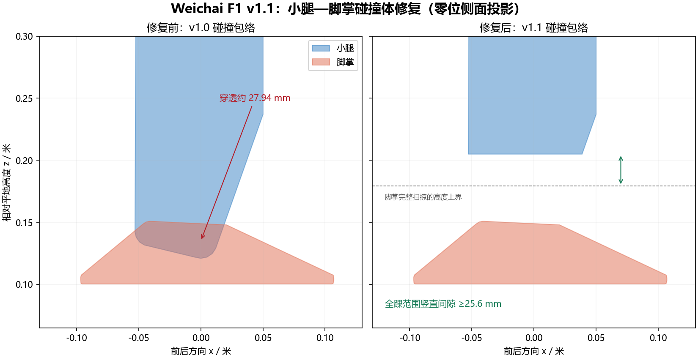

# Weichai F1 12DOF 模型 v1.1

当前模型资源版本为 **v1.1**，由 `VERSION`、URDF 的 robot 名称和 MJCF 的 model 名称共同标记。
训练任务继续使用 `weichai_f1_12_dh_stand`，模型入口路径可直接由现有配置加载。

## v1.1 修改说明（2026-10-21）

旧的小腿碰撞网格在转成单个凸包后，填满了踝部装配间隙。零位时，
`left/right_knee_pitch_link` 与同侧 `ankle_roll_link` 的碰撞包络穿透约 27.94 mm。

v1.1 重建左右小腿的闭合凸碰撞网格，为踝俯仰、踝滚转各 `±0.523599 rad` 的完整脚掌扫掠范围留出空间：

- 新网格在小腿 link 坐标系内以米为单位，URDF 使用单位缩放、零位姿；MJCF 引用同一份网格。
- 小腿碰撞包络的下界从局部 `z ≈ -0.343 m` 提高至 `z = -0.259 m`。
- 脚掌完整踝关节扫掠范围与小腿之间，竖直分离量至少约 **25.63 mm**。
- 原外观网格、惯性参数、关节定义和脚掌碰撞网格沿用原资源；模型本身仍启用自碰撞。

该小腿碰撞包络省略了下端约 84 mm 的踝部装配区域，保留原凸包约 82.5% 的体积。
这是用于运动训练的简化碰撞几何；需要精细评估该区域与障碍物接触时，应补充局部碰撞建模。



## 资源文件

| 文件 | 用途 |
| --- | --- |
| [URDF](urdf/weichai_f1_12.urdf) | Isaac Gym 训练模型，robot 名为 `weichai_f1_12_v1_1` |
| [MJCF](mjcf/weichai_f1_12.xml) | MuJoCo 模型，model 名为 `weichai_f1_12_v1_1` |
| `meshes/collision/v1_1/*.stl` | 新的米制小腿凸碰撞网格 |
| [几何参数及校验和](collision_geometry_v1_1.json) | 来源网格、裁切面、关节范围、间隙和 SHA256 |
| [验证结果](validation_v1_1.json) | 本地几何回归结果 |

`meshes/mujoco_stl/` 中的原小腿碰撞网格作为生成来源保留；v1.1 的活动碰撞体引用 `meshes/collision/v1_1/`。
原 CAD 网格的毫米缩放与新碰撞网格的米制单位分别处理。

## 验证范围

本地使用 MuJoCo 3.15.0，分别检查直接导入的 URDF 和原生 MJCF，保留自碰撞且未增加碰撞排除对：

| 检查 | 每种模型的结果 |
| --- | --- |
| 旧碰撞体对照 | 零位 4 个内部接触点，最大穿透约 27.94 mm |
| v1.1 零位与轻微屈膝站姿 | 内部接触点均为 0 |
| 参考步态 201 个相位姿态 | 内部接触点均为 0 |
| 踝俯仰/滚转 41 × 41 组角度 | 内部接触点均为 0，采样最小几何距离约 29.75 mm |
| 全踝范围解析支撑上界 | 竖直间隙至少约 25.63 mm |
| 双脚触地 | 保留左右脚掌与地面的接触 |
| 关节与执行器顺序 | 12 个关节及执行器顺序检查通过 |

这些是本地凸碰撞几何检查；Isaac Gym/PhysX 运行回归及 v1.1 策略训练尚需另行执行。
云端既有训练使用其创建时的代码提交，使用 v1.1 训练需要包含本次资源修改的提交。

## 重新生成与检查

在仓库根目录运行：

```bash
python resources/robots/weichai_f1_12/tools/build_collision_v1_1.py
python resources/robots/weichai_f1_12/tools/validate_geometry.py
```

生成工具需要 NumPy、SciPy 和 trimesh；验证工具还需要提供 `mj_geomDistance` 的 MuJoCo（本次使用 3.15.0）。
这些是离线模型工具的依赖，训练流程直接加载生成后的 URDF 和 STL。
